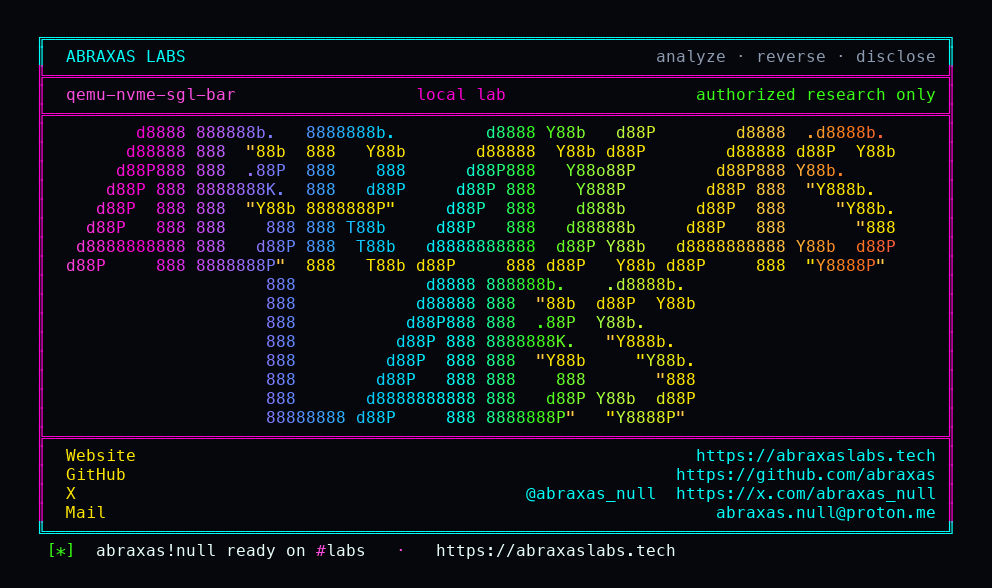

<p align="center">
  
</p>

<p align="center">
  <a href="https://abraxaslabs.tech"><strong>abraxaslabs.tech</strong></a>
  &nbsp;·&nbsp;
  <a href="https://github.com/abraxas">github.com/abraxas</a>
  &nbsp;·&nbsp;
  <a href="https://x.com/abraxas_null">@abraxas_null</a>
  &nbsp;·&nbsp;
  <a href="mailto:abraxas.null@proton.me">abraxas.null@proton.me</a>
  &nbsp;·&nbsp;
  <a href="https://github.com/abraxas/qemu-nvme-sgl-bar">qemu-nvme-sgl-bar</a>
</p>

# qemu-nvme-sgl-bar

**QEMU** `v11.1.2` (`4fc49f46dc95d4a27de2509e7fceb2931e91faeb`) - NVMe

**Class:** UAF (incomplete BAR0 deny-list; spanning SGL DMA into MMIO). **Reach:** Local (guest).

[`nvme_map_addr`](https://github.com/qemu/QEMU/blob/v11.1.2/hw/nvme/ctrl.c) is the leftover of [CVE-2021-3929](https://www.cve.org/CVERecord?id=CVE-2021-3929). The iomem check is start-only. An SGL data block that begins just before BAR0 and runs into MBAR is accepted. Identify still reports `NVME_CTRL_SGLS_SUPPORT_NO_ALIGN`. PRP cannot span a page-aligned BAR. SGL can.

An NVMe READ with that SGL goes through `nvme_blk_read` -> `dma_blk_read`. Bounce DMA then `address_space_write`s guest disk bytes onto BAR0 from the DMA helper callback, outside the NVMe `mem_reentrancy_guard` BH. Guest-chosen zeros land on `CC`. `nvme_ctrl_reset` runs while the live `NvmeRequest` is still in the completion path.

**A guest NVMe driver can span SGL into BAR0, reset the controller from DMA unmap, and race the live request.**

| | |
|---|---|
| ID | no CVE yet |
| CWE | [CWE-119](https://cwe.mitre.org/data/definitions/119.html) / [CWE-416](https://cwe.mitre.org/data/definitions/416.html) |
| CVSS | **High: 8.2** `CVSS:3.1/AV:L/AC:L/PR:H/UI:N/S:C/C:H/I:H/A:H` |
| Product | [QEMU](https://github.com/qemu/QEMU) |
| Affected | **v11.1.2** (`4fc49f46`) |
| Auth | guest kernel with an NVMe controller (SGL) |
| License | [GNU Affero GPL v3.0](LICENSE) |
| Lab | `127.0.0.1:18720` qtest only |

## What an attacker can do

Who: untrusted guest kernel with an NVMe PCI device. Guest-to-host.

### Integrity (lab-proven)

| Method | Sink | Privilege |
|---|---|---|
| NVMe READ SGL `addr=0xdfffffec` `len=0x1000` (starts 0x14 before BAR0 at `0xe0000000`) | `nvme_map_addr` / `nvme_addr_is_iomem` start-only | Mapping accepted. Control Identify with start-in-BAR0 still returns `0x4004` (DATA_TRAS_ERROR \| DNR). |
| Bounce unmap writes LBA zeros onto `CC` | `address_space_write` of DMA bounce into BAR0, `nvme_write_bar` | **CSTS.RDY drops.** `pci_nvme_mmio_stopped` in the log. Controller reset from the DMA helper, not from a guest MMIO store in the NVMe BH. |

### Integrity (inferred)

Guest-controlled disk bytes on `CC` / other BAR0 registers. Reset cancels inflight AIOs, but the request that is *inside* DMA unmap/completion still races the live `NvmeRequest` / SQ / CQ. Same class as CVE-2021-3929; the deny-list never covered a spanning SGL. DIF bounce (`nvme_tx` from an AIO callback) has the same hole.

### Availability (lab-proven)

Controller stops (`CSTS.RDY=0`, `mmio-stopped=1`). Hypervisor process stays up in this lab (`asan=0`). A nested reset UAF of `NvmeRequest` is the inferred next step, not the witness this run printed.

### Recon

None. NVMe BAR0 is guest-visible.

### Adjacent surface that stays closed

- Start address inside BAR0: blocked. That is CVE-2021-3929. Lab control SC `0x4004`.
- Admin Identify / Get Log: SGLs rejected. PRP cannot span.
- CQ/SQ-in-BAR0 CQE posts: `nvme_post_cqes` BH is guarded, nested MMIO is `MEMTX_ACCESS_ERROR`.
- CMB/PMR mapping already checks both ends.
- Cross-namespace Copy reset UAF / DIF bounce overflow: public, fixed on this pin.

The lab does not demonstrate RIP control or a guest-to-host shell. The class is spanning DMA into MMIO plus controller reset of a live request.

## How I found it

CVE-2021-3929 taught the tree to reject iomem as an NVMe mapping start. I asked whether the end of an SGL data block was in that test. It is not. CMB/PMR already check both ends. BAR0 does not. Identify advertises unaligned SGL.

Wrong turns: PRP (page-bounded, cannot sneak into a page-aligned BAR from the previous page); admin commands (SGL rejected); hoping ASan would fire on the first READ (the witness is `CSTS.RDY` and `pci_nvme_mmio_stopped`, not a heap report).

## Lab

```bash
cd lab
./run.sh
```

Target **only** `127.0.0.1:18720` (qtest). Pin is cloned from github.com/qemu/QEMU tag `v11.1.2` / `4fc49f46`. Loopback. Witness-only. Disk image is 1 MiB of zeros so bounce writes `CC.EN=0`.

```text
SUCCESS qemu-nvme-sgl-bar control-sc=0x4004 span-addr=0xdfffffec span-end=0xe0000fec csts-rdy-before=1 csts-rdy-after=0 mmio-stopped=1 asan=0 QEMU-NVME-SGL-BAR-WITNESS
```

Replay: `python3 qemu-nvme-sgl-bar-Abraxas-Labs.py`.

## The fix

Reject a mapping if any byte of `[addr, addr+len)` sits in BAR0 (and MSI-X), matching CMB/PMR. `nvme_addr_is_iomem` should take a range, not a start. Keep the start-in-BAR0 reject as the CVE-2021-3929 control.

## References

- [github.com/qemu/QEMU](https://github.com/qemu/QEMU) tag [v11.1.2](https://github.com/qemu/QEMU/releases/tag/v11.1.2) commit `4fc49f46dc95d4a27de2509e7fceb2931e91faeb`
- [`nvme_map_addr`](https://github.com/qemu/QEMU/blob/v11.1.2/hw/nvme/ctrl.c) / `nvme_addr_is_iomem`
- Nearby patched (not this span): [CVE-2021-3929](https://www.cve.org/CVERecord?id=CVE-2021-3929) start-in-BAR0
- Same pin: [qemu-xhci-complete-uaf](https://github.com/abraxas/qemu-xhci-complete-uaf) · [qemu-colo-l4-oob](https://github.com/abraxas/qemu-colo-l4-oob)
- Series: [QEMU 11.1.2 leftovers](https://abraxaslabs.tech/research/qemu-11.1.2-leftovers)
- [CWE-119](https://cwe.mitre.org/data/definitions/119.html) · [CWE-416](https://cwe.mitre.org/data/definitions/416.html)

## License

GNU Affero GPL v3.0. See [LICENSE](LICENSE). Loopback lab only. No warranty.
